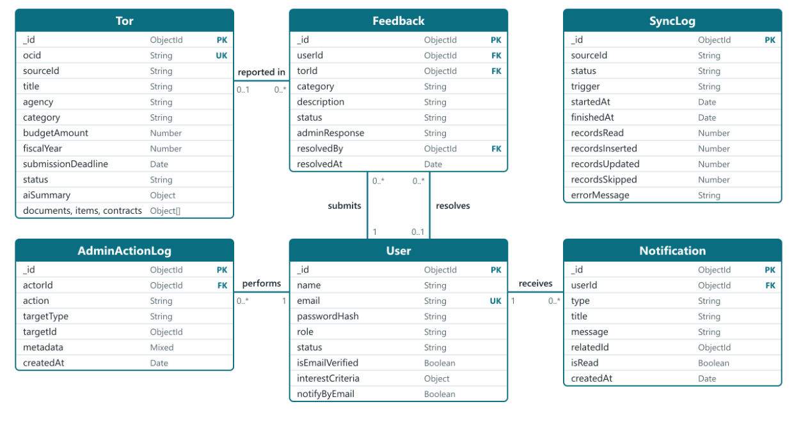

# TOR Insight — ER Diagram

The diagram shows the main MongoDB collections and how they refer to each other. MongoDB has no foreign keys: the FK fields hold the `_id` of a document in another collection (a Mongoose `ref`), and the application keeps them consistent.

## Collections

**Tor**: one Terms of Reference collected from BMA Open Contracting, Bangkok e-GP or National e-GP. `ocid` is unique, so syncing the same TOR again updates it instead of adding a copy. `status` is `draft`, `published` or `archived`; only published TORs are shown to the public.

**User**: an account. `email` is unique. `role` is `end_user` or `admin`, and `status` is `active` or `disabled`. `interestCriteria` holds the saved search used for alerts.

**Feedback**: a report from a user, about a TOR or about the app. `category` is `incorrect_info`, `outdated_info`, `broken_link`, `app_feedback` or `other`, and `status` is `pending`, `reviewed` or `resolved`.

**Notification**: an in-app message for one user. `type` is `feedback_resolved`, `tor_match` or `new_feedback`, and `relatedId` points to the TOR or feedback it is about.

**AdminActionLog**: an audit record of an administrator's action. `targetType` is `User`, `Feedback` or `Tor`, and `targetId` is that document's `_id`.

**SyncLog**: one run of a data sync. `status` is `in_progress`, `success` or `failed`, and `trigger` is `scheduled` or `manual`. It has no link to other collections.

## Relationships

| Relationship | Cardinality | Field |
|---|---|---|
| User submits Feedback | 1 to 0..* | `Feedback.userId` |
| User resolves Feedback | 0..1 to 0..* | `Feedback.resolvedBy` |
| Feedback is reported in a Tor | 0..* to 0..1 | `Feedback.torId` (empty for app feedback) |
| User receives Notification | 1 to 0..* | `Notification.userId` |
| User performs AdminActionLog | 1 to 0..* | `AdminActionLog.actorId` |

## Not shown in the diagram

The diagram shows the main fields only. The `User` collection also stores the fields used for login security:

- MFA: `mfaEnabled`, the encrypted TOTP secret and the pending login challenge.
- Sessions: `tokenVersion`, which is increased to end all of a user's sessions at once.
- Sign in with Google: `googleId`, unique when present.
- The email verification OTP and the password reset token (the reset token is stored as a hash). Neither is returned by queries unless asked for.

Two short-lived collections support Sign in with Google. MongoDB deletes their documents automatically when `expiresAt` passes:

- **OAuthState**: one pending sign-in. It stores a hash of the state, the PKCE code verifier and the nonce.
- **OAuthLoginCode**: a single-use code, linked to `User` by `userId`, that the frontend exchanges for an access token.
