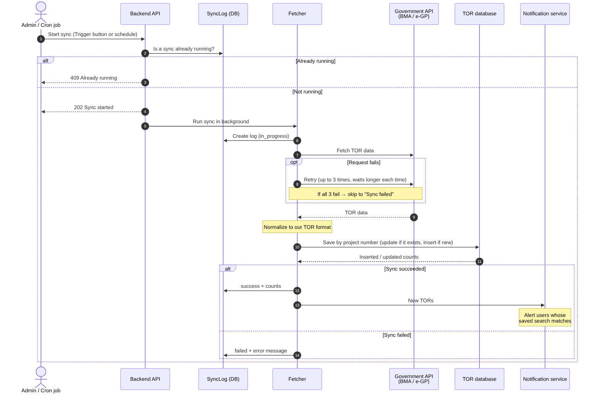

# TOR Insight — Sequence Diagram

The diagram shows how TOR data gets into the platform: a sync that fetches TORs from a government source and saves them in our database.

## Steps

**Start (1–4)**
- A sync starts from the Trigger button in the admin dashboard or from the daily schedule.
- The backend checks if a sync is already running. If it is, it answers 409 and stops, so the same sync never runs twice.
- Otherwise it answers 202 and the sync runs in the background.

**Fetch and save (5–11)**
- The fetcher logs that the sync has started.
- It fetches TOR data from the government API. If a request fails, it retries up to 3 times and waits longer each time.
- The data is converted to our TOR format.
- Each TOR is saved by its project number. If it already exists it is updated, so there are no duplicates.

**Finish (12–14)**
- Success: the counts are logged, and users with a matching saved search are notified about the new TORs.
- Failure: the error is logged, so the admin sees it on the data collection dashboard.
