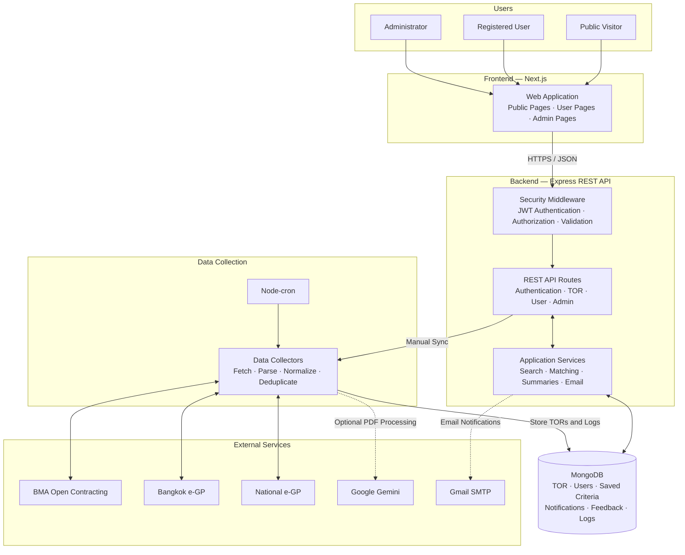

# TOR Insight — System Architecture

## Diagram explanation

- **Users and frontend:** Public visitors, registered users, and administrators use the Next.js web application. The frontend calls the backend over HTTPS with JSON; authenticated requests include a Bearer token.
- **Backend and security:** Express middleware handles request protections and validates JWTs for protected endpoints. Admin endpoints also require an administrator role. The API routes requests to application services for TOR search, saved-criteria matching, summaries, and email-related operations.
- **Database:** MongoDB stores TOR records, user profiles and saved notification criteria, in-app notifications, feedback, sync history, and admin audit logs. The collectors write collected TORs and sync logs; application services read and update application data.
- **Data collection:** Node-cron can start scheduled collection, and administrators can trigger supported syncs through the API. Collectors fetch records from BMA Open Contracting and the two e-GP sources, then parse, normalize, and deduplicate them before storing results. Gemini is an optional integration for supported PDF processing and summaries.
- **Notifications and email:** Services match new TORs against users' saved criteria and store in-app notifications. Gmail SMTP is used for configured email flows, including verification, password reset, TOR matches, and feedback responses.

## Main API groups

| API prefix | Purpose |
| --- | --- |
| `/api/auth` | Registration, login, email verification, and password reset |
| `/api/users` | Current-user profile, settings, and password changes |
| `/api/tors` | Public TOR search, details, filters, and summaries |
| `/api/stats` | Public procurement statistics |
| `/api/feedback` | User feedback submission and history |
| `/api/notifications` | In-app notifications and read state |
| `/api/admin` | Admin TOR, user, feedback, and data-sync operations |

## Input validation and application limits

Validation is enforced in the Express API; frontend checks are for usability only. JSON request bodies must be objects, write routes with defined field allowlists reject unsupported fields, and query parameters must be single scalar values (repeated or nested values are rejected). String lengths are measured in JavaScript characters unless the rule specifies UTF-8 bytes. Numeric inputs must be finite and within the ranges below; related bounds are checked together.

| Input | Validation rule |
| --- | --- |
| Registration name | Trimmed, 1–100 characters. |
| Email | String with a basic address structure, no whitespace inside, maximum 254 characters; normalized to lowercase and trimmed before lookup/storage. |
| Password | At least 8 and at most 128 Unicode characters at registration/reset/change. New passwords are checked against the first 10,000 entries of a popularity-ranked common-password corpus and Have I Been Pwned's k-anonymity range API; the complete password is never sent to HIBP. A failed/unavailable breach check fails closed with a temporary-service error. New passwords are SHA-256 pre-hashed and then bcrypt-hashed so bcrypt's 72-byte input limit cannot truncate long or Unicode passwords. Existing direct-bcrypt hashes are verified and upgraded to the new scheme after successful login. Passwords are otherwise used as submitted (not trimmed or case-normalized). |
| Email verification OTP | Exactly six decimal digits; expires after 10 minutes and is bound to the account email. |
| Reset token | Exactly 64 hexadecimal characters, single-use, and expires after 30 minutes. |
| Profile name | Trimmed, 1–100 characters. `notifyByEmail` must be a boolean. |
| Saved criteria lists | `categories`, `agencies`, and `keywords` are arrays of at most 20 non-empty strings, each at most 100 characters. |
| Saved criteria amounts/year | Minimum and maximum budgets are finite, non-negative amounts no greater than 1,000,000,000,000,000; minimum must not exceed maximum. Fiscal year is a whole number from 1900 through 2200. |
| TOR search | `sort` is `date`, `budget`, or `relevance`; `bidding` is `open`, `upcoming`, or `closed`. Keyword is at most 200 characters; agency/category at most 100. Fiscal year is a whole number from 1900 through 2200. Budgets are finite, non-negative, and at most 1,000,000,000,000,000; minimum must not exceed maximum. Page is a positive integer no greater than 1,000,000; page size is a positive integer capped at 100 (default 20). |
| Feedback | Category is one of `incorrect_info`, `outdated_info`, `broken_link`, `app_feedback`, or `other`. Description is 10–2,000 characters after trimming. TOR references must be valid MongoDB IDs; reference-required categories must include one. |
| Admin search and edits | Search strings have route-specific limits (100 characters for users, 200 for TORs); regular-expression metacharacters are escaped. Status/role/source values use explicit enumerations. IDs are validated before database operations. TOR amounts and fiscal years follow the numeric rules above; text fields have explicit length limits. |

## Business and resource limits

Rate limits use the requester's IP address and in-memory `express-rate-limit` counters. Production deployments behind a reverse proxy must configure Express trusted-proxy settings for accurate client IP handling.

| Function | Limit |
| --- | --- |
| General API traffic | 300 requests per 15 minutes. |
| Login, registration, forgot/reset password | 10 requests per 15 minutes. |
| Email verification and OTP resend | 5 requests per 10 minutes. |
| Search, filter options, and TOR statistics | 60 requests per minute. |
| Uncached AI TOR summaries | 20 requests per minute; generated summaries are cached in MongoDB. |
| Feedback submissions | At most 10 per user in a rolling 24-hour period; identical descriptions are rejected for five minutes. |
| PDF processing | Source-PDF fetches time out after 20 seconds; AI requests accept at most 15 MiB per PDF, and only files beginning with the `%PDF` signature are included. If fetching or validation fails, a summary may be generated from stored fields only. |

Search and summary generation are the user-facing resource-intensive operations: search uses bounded pagination and a dedicated limiter, and AI summaries are cached and separately rate-limited. Scheduled/manual data synchronization is restricted to administrators and is recorded in sync logs; optional PDF summary processing can degrade gracefully when the AI service is unavailable.

## Authentication pathways

The interactive authentication pathway requires email, password, and authenticator-app TOTP for every account, including administrators. Email OTP at registration only verifies email ownership and is not treated as an authentication factor. Legacy accounts are required to enroll TOTP on their next successful password login; no application access token is issued until enrollment is confirmed. TOTP codes are six digits, have a 30-second period, are rate-limited, and cannot be replayed. TOTP seeds are AES-256-GCM encrypted at rest using the separate `MFA_ENCRYPTION_KEY` environment variable, which must be a randomly generated 32-byte value represented as 64 hexadecimal characters. MFA setup tokens expire after 10 minutes; login challenges expire after five minutes. Password reset does not disable or bypass MFA. Login returns one generic failure for unknown, disabled, unverified, and wrong-password accounts. Registration, verification/resend-OTP, and forgot-password responses also avoid disclosing whether an email is registered; those endpoints impose a 250 ms minimum response duration to reduce timing signals.

Access tokens are signed using HS256 only and have an eight-hour absolute lifetime. The backend enforces a 30-minute inactivity timeout using each account's last authenticated activity. “Remember me” only chooses browser local storage rather than session storage; it does not extend the token lifetime. `end_user` accounts can manage their own profile, criteria, feedback, and notifications; `admin` accounts can also access administrative user, TOR, feedback, and sync operations. The database is authoritative for account role and enabled/disabled status; token role claims do not grant privileges. Logout increments the account's token version and invalidates all its active tokens across devices. Administrators can revoke all sessions for one account without disabling it, or revoke sessions for every account; both operations are audit logged. Password change/reset and account disabling also revoke existing tokens; after a password change the user must sign in again. Enabling a previously disabled account does not restore tokens issued before it was disabled.

An administrator can initiate a password recovery by sending the user a single-use, 30-minute reset link. The administrator cannot set, view, or choose the user's password. Reset requests and password changes trigger email security notifications; administrative reset initiation is audit logged. Permanently deleting an account requires the administrator's current password in addition to the active authenticated session. Login, registration, and password recovery share the 10-per-15-minute authentication limiter; verification and OTP resend use the five-per-10-minute OTP limiter. There is no Google SSO or other identity-provider login implemented at present. If another pathway is added, document its flow and apply equivalent account verification, MFA where required, throttling, and backend token validation before release.

Scheduled collection and external integrations depend on deployment configuration and credentials; the diagram does not imply that every optional schedule or service is enabled in every environment.