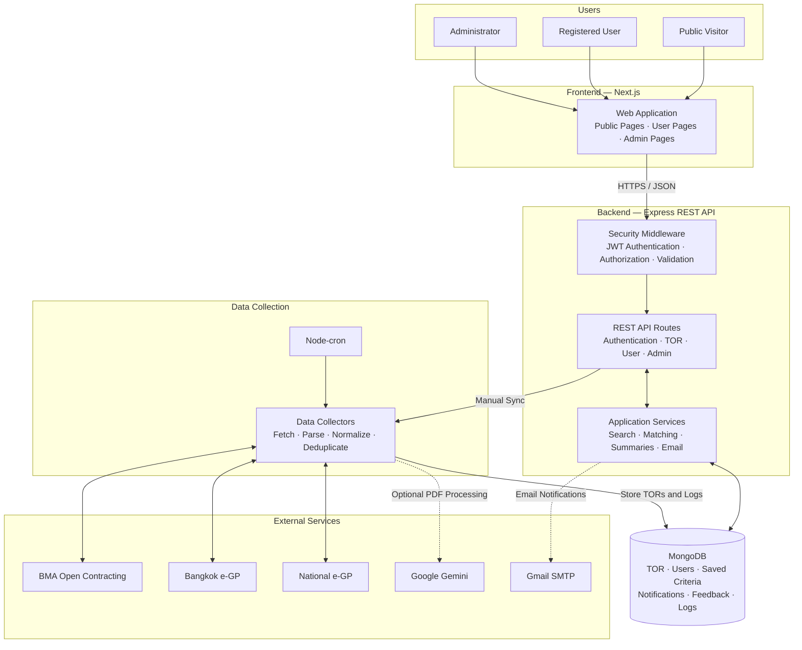

# TOR Insight — System Architecture

## Diagram explanation

- **Users and frontend:** Public visitors, registered users, and administrators use the Next.js web application. The frontend calls the backend over HTTPS with JSON; authenticated requests include a Bearer token.
- **Backend and security:** Express middleware handles request protections and validates JWTs for protected endpoints. Admin endpoints also require an administrator role. The API routes requests to application services for TOR search, saved-criteria matching, summaries, and email-related operations.
- **Database:** MongoDB stores TOR records, user profiles and saved notification criteria, in-app notifications, feedback, sync history, and admin audit logs. The collectors write collected TORs and sync logs; application services read and update application data.
- **Data collection:** Node-cron can start scheduled collection, and administrators can trigger supported syncs through the API. Collectors fetch records from BMA Open Contracting and the two e-GP sources, then parse, normalize, and deduplicate them before storing results. Gemini is an optional integration for supported PDF processing and summaries.
- **Notifications and email:** Services match new TORs against users' saved criteria and store in-app notifications. Gmail SMTP is used for configured email flows, including verification, password reset, TOR matches, and feedback responses.

## Main API groups

| API prefix | Purpose |
| --- | --- |
| `/api/auth` | Registration, login, email verification, and password reset |
| `/api/users` | Current-user profile, settings, and password changes |
| `/api/tors` | Public TOR search, details, filters, and summaries |
| `/api/stats` | Public procurement statistics |
| `/api/feedback` | User feedback submission and history |
| `/api/notifications` | In-app notifications and read state |
| `/api/admin` | Admin TOR, user, feedback, and data-sync operations |

## Input validation and application limits

Validation is enforced in the Express API; frontend checks are for usability only. JSON request bodies must be objects, write routes with defined field allowlists reject unsupported fields, and query parameters must be single scalar values (repeated or nested values are rejected). String lengths are measured in JavaScript characters unless the rule specifies UTF-8 bytes. Numeric inputs must be finite and within the ranges below; related bounds are checked together.

| Input | Validation rule |
| --- | --- |
| Registration name | Trimmed, 1–100 characters. |
| Email | String with a basic address structure, no whitespace inside, maximum 254 characters; normalized to lowercase and trimmed before lookup/storage. |
| Password | No character-composition rules; at least 8 characters at registration/reset/change and at most 72 UTF-8 bytes to avoid bcrypt truncation. Passwords are otherwise used as submitted (not trimmed or case-normalized). |
| Email verification OTP | Exactly six decimal digits; expires after 10 minutes and is bound to the account email. |
| Reset token | Exactly 64 hexadecimal characters, single-use, and expires after 30 minutes. |
| Profile name | Trimmed, 1–100 characters. `notifyByEmail` must be a boolean. |
| Saved criteria lists | `categories`, `agencies`, and `keywords` are arrays of at most 20 non-empty strings, each at most 100 characters. |
| Saved criteria amounts/year | Minimum and maximum budgets are finite, non-negative amounts no greater than 1,000,000,000,000,000; minimum must not exceed maximum. Fiscal year is a whole number from 1900 through 2200. |
| TOR search | `sort` is `date`, `budget`, or `relevance`; `bidding` is `open`, `upcoming`, or `closed`. Keyword is at most 200 characters; agency/category at most 100. Fiscal year is a whole number from 1900 through 2200. Budgets are finite, non-negative, and at most 1,000,000,000,000,000; minimum must not exceed maximum. Page is a positive integer no greater than 1,000,000; page size is a positive integer capped at 100 (default 20). |
| Feedback | Category is one of `incorrect_info`, `outdated_info`, `broken_link`, `app_feedback`, or `other`. Description is 10–2,000 characters after trimming. TOR references must be valid MongoDB IDs; reference-required categories must include one. |
| Admin search and edits | Search strings have route-specific limits (100 characters for users, 200 for TORs); regular-expression metacharacters are escaped. Status/role/source values use explicit enumerations. IDs are validated before database operations. TOR amounts and fiscal years follow the numeric rules above; text fields have explicit length limits. |

## Business and resource limits

Rate limits use the requester's IP address and in-memory `express-rate-limit` counters. Production deployments behind a reverse proxy must configure Express trusted-proxy settings for accurate client IP handling.

| Function | Limit |
| --- | --- |
| General API traffic | 300 requests per 15 minutes. |
| Login, registration, forgot/reset password | 10 requests per 15 minutes. |
| Email verification and OTP resend | 5 requests per 10 minutes. |
| Search, filter options, and TOR statistics | 60 requests per minute. |
| Uncached AI TOR summaries | 20 requests per minute; generated summaries are cached in MongoDB. |
| Feedback submissions | At most 10 per user in a rolling 24-hour period; identical descriptions are rejected for five minutes. |
| PDF processing | Source-PDF fetches time out after 20 seconds; AI requests accept at most 15 MiB per PDF, and only files beginning with the `%PDF` signature are included. If fetching or validation fails, a summary may be generated from stored fields only. |

Search and summary generation are the user-facing resource-intensive operations: search uses bounded pagination and a dedicated limiter, and AI summaries are cached and separately rate-limited. Scheduled/manual data synchronization is restricted to administrators and is recorded in sync logs; optional PDF summary processing can degrade gracefully when the AI service is unavailable.

## Authentication pathways

The current interactive authentication pathway is email and password. Registration sends an email OTP to verify the address before login; that OTP is an account-verification step, not a second factor at each login. Login, registration, and password recovery share the 10-per-15-minute authentication limiter; verification and OTP resend use the five-per-10-minute OTP limiter. There is no Google SSO or other identity-provider login implemented at present. If another pathway is added, document its flow and apply equivalent account verification, throttling, and backend token validation before release.

Scheduled collection and external integrations depend on deployment configuration and credentials; the diagram does not imply that every optional schedule or service is enabled in every environment.