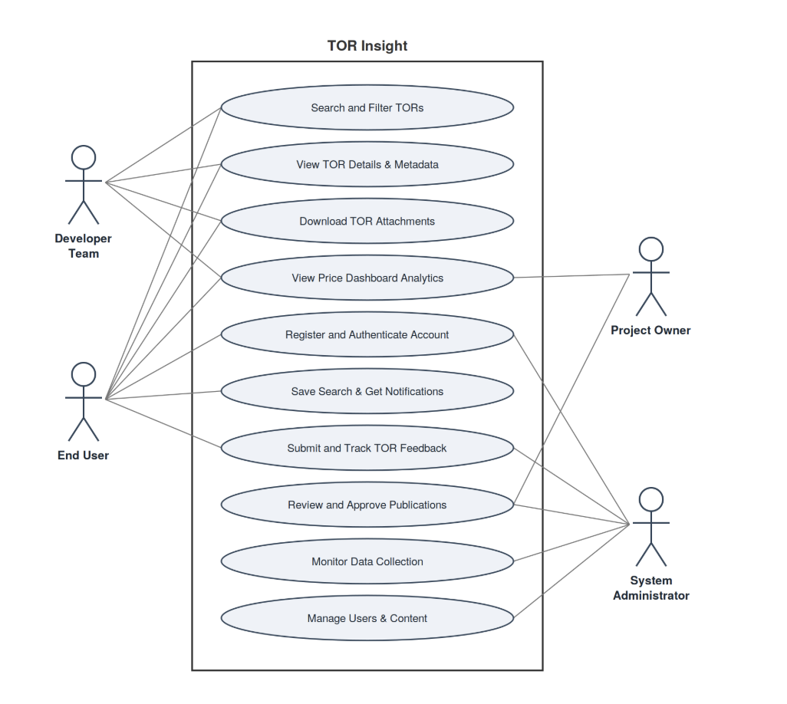

# TOR Insight — Use Case Diagram

The diagram shows the four types of users and what each of them can do in TOR Insight.

## Actors

**End User**: a user looking for procurement opportunities. They can search and filter TORs, view TOR details, download attachments and view the price dashboard. With an account they can also save searches and get notified about new matching TORs, and report incorrect TOR data through feedback.

**Developer Team**: software companies and developers looking for relevant TORs. They can search and filter TORs, view details, download attachments and view the price dashboard.

**Project Owner**: views the price dashboard and reviews and approves TORs before they are published.

**System Administrator**: logs in to the admin panel, handles user feedback, reviews and approves TORs, monitors the automatic data collection from government sources, and manages users and content.

## Use cases

| Use case | Description |
|---|---|
| Search and Filter TORs | Find TORs by keyword, agency, category, fiscal year and budget |
| View TOR Details & Metadata | See the scope, budget, deadline and source of a TOR |
| Download TOR Attachments | Download the original documents (PDF, DOCX, ZIP) |
| View Price Dashboard Analytics | See budget statistics per agency, category and year |
| Register and Authenticate Account | Create an account and log in |
| Save Search & Get Notifications | Save search criteria and get alerts for new matching TORs |
| Submit and Track TOR Feedback | Report incorrect data and follow the status of the report |
| Review and Approve Publications | Approve collected TORs before they become public |
| Monitor Data Collection | Follow the sync jobs, their status and errors |
| Manage Users & Content | Disable or delete users and edit TOR content |
